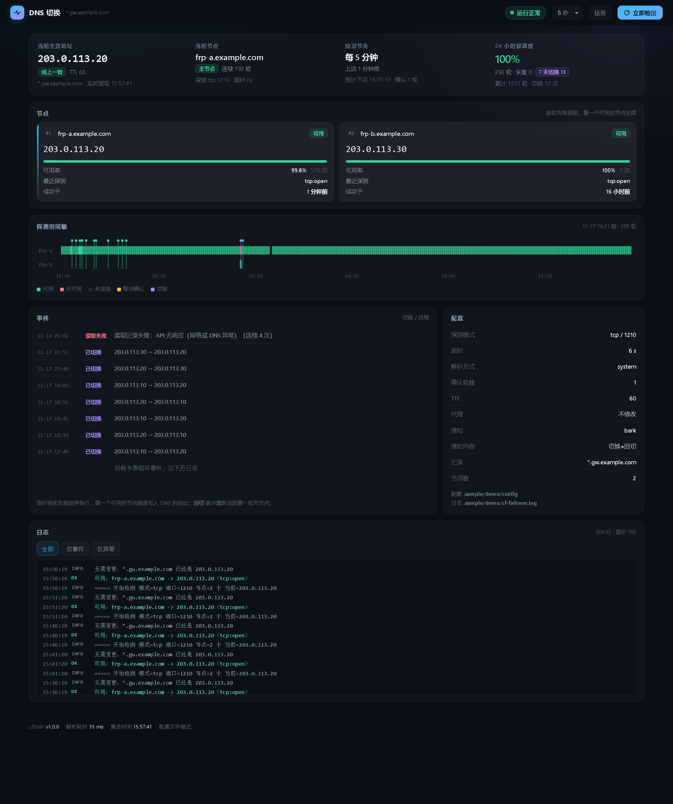

# cf-dns-failover

[](https://github.com/jhonlinus/cf-dns-failover/actions/workflows/shellcheck.yml)
[](LICENSE)

A minimal Cloudflare DNS failover script. It probes a prioritised list of
nodes and points a DNS record at the first one that answers.

> [中文文档](README.md)

```
node A healthy  ->  DNS = A   (nothing to do, exit)
node A down     ->  DNS = B   (write record + notify)
node A back     ->  DNS = A   (automatic failback)
```

## Why

Cloudflare's free plan has no health checks. Multiple A records only move the
choice to the client: no probing, sticky per-resolver caching, and most
non-browser clients never try the second address.

The real options are Load Balancing ($5/mo) or doing it yourself. This is the
latter — no proxy, DNS records only, so **zero added latency** on the normal path.

## Features

- Priority selection, not round-robin. Re-evaluated every run, so failback
  needs no extra logic.
- Two probe modes: `tcp` (port only) and `http` (status code + optional keyword).
- Debounce: require N consecutive agreeing rounds before rewriting DNS.
- Refuses to act when the current record cannot be read.
- Multiple records per run.
- Nine notification backends: Bark, WeCom, DingTalk, Feishu, PushPlus,
  Telegram, ntfy, generic webhook, or none.
- `--dry-run` to see decisions without touching anything.
- Built-in `flock` so overlapping cron runs are harmless.
- No dependencies beyond `bash` and `curl`.
- Optional web dashboard (`dashboard/`) that turns the log into a live view —
  read-only, never rewrites your config. ([screenshot](#dashboard-optional))

## Quick start

```bash
git clone https://github.com/jhonlinus/cf-dns-failover.git
cd cf-dns-failover
sudo ./install.sh

sudo vi /etc/cf-failover/config    # fill in DNS_TOKEN, DNS_RECORDS, NODE_HOSTS
sudo cf-failover --check
sudo cf-failover --dry-run
sudo cf-failover
```

## Configuration

See [`config.example`](config.example) for the annotated template.

| Key | Description |
|---|---|
| `DNS_TOKEN` | Cloudflare API token, `Zone / DNS / Edit`, scoped to one zone |
| `DNS_RECORDS` | `"ZONE_ID\|RECORD_ID\|NAME"` per entry |
| `NODE_HOSTS` | Nodes in priority order; hostnames or IPv4 |
| `PROBE_MODE` | `tcp` or `http` |
| `PROBE_PORT` | Port to probe (FRP: usually `vhostHTTPPort`) |
| `PROBE_HOST` | Required for `http` mode; must have a live tunnel |
| `CONFIRM_TIMES` | Rounds that must agree before switching |
| `DNS_TTL` | TTL written with the record |
| `NOTIFY_TYPE` | `bark`, `wecom`, `dingtalk`, `feishu`, `pushplus`, `telegram`, `ntfy`, `webhook`, `none` |
| `NODE_LOOKUP` | `system` or `authoritative` |
| `FLUSH_DNS_CACHE` | `auto`, `always` or `never` |

### Hostname nodes can go stale

A hostname in `NODE_HOSTS` is re-resolved on every run, and the answer is only
as fresh as the slowest cache in the chain. That is not a "failover is late"
problem: the script probes an address that is no longer in use, decides the
node is down, and writes that dead address into DNS.

Two ways out. Literal IPs remove resolution entirely. Or:

```bash
NODE_LOOKUP="authoritative"
```

This walks up to the zone's own nameserver and queries it with `+norecurse`,
so no cache gets a vote. Costs a few extra DNS round trips, needs `dig`, and
falls back to `system` with a warning if the authoritative server is
unreachable.

`FLUSH_DNS_CACHE` only clears this machine — `resolvectl`, `systemd-resolve`,
`nscd`, macOS `mDNSResponder`. It cannot clear your ISP's recursive resolver,
and it cannot clear `/etc/hosts`, which never expires. If the stale answer is
upstream, use `authoritative`.

### Choosing a probe mode

`tcp` detects a dead host. It **cannot** detect a dead tunnel: frps keeps
`vhostHTTPPort` listening after frpc disconnects, so the handshake still
succeeds while every request returns 502.

`http` sends a real request through the candidate IP with `curl --resolve`,
catching both cases. It requires `PROBE_HOST` to point at a hostname that
actually has a working tunnel.

Note that many frps instances return 502 for any unmatched vhost, including
made-up subdomains. A 502 therefore proves the request reached frps, not that
the tunnel is alive — which is exactly why status-code allowlisting beats
port checking.

## Scheduling

```cron
*/5 * * * * /usr/local/bin/cf-failover --quiet
```

`install.sh --systemd` sets up a timer instead.

Pick `CONFIRM_TIMES` to match the interval: `2` at one minute, `1` at five.
Two probes sixty seconds apart can be fooled by a blip; two probes five
minutes apart cannot.

## Dashboard (optional)

The script has no UI — normally you watch it with `tail -f`. `dashboard/` adds a
zero-dependency panel: one `cfdash.py` (Python 3.8+, stdlib only) plus one
`index.html`, both read nothing but your existing config, state files and log.



- Shows the IP currently in DNS, verified against the Cloudflare API (mismatch is flagged)
- Per-node health, which node is active, whether it is the primary one
- 24h round count, failures, switches; when the next run is due
- A timeline of every probe round, with switch markers
- Event list and full log, both filterable
- One button to run a check now — with a dry-run option

```bash
python3 dashboard/cfdash.py                 # 127.0.0.1:8077
python3 dashboard/cfdash.py --auth u:p      # add Basic auth
python3 dashboard/cfdash.py --no-run        # read-only, hide the trigger button
```

It auto-detects both layouts: `/etc/cf-failover/config` (this repo) and the
older inline-config script installed by a 1Panel cron job. Override with
`--config` / `--log` if yours lives elsewhere.

A ready-made **fnOS (FeiNiu) package** is in `fnos/` — install it from the app
center and it appears on the desktop, served through `/app/cfdns/` without
occupying a port. See [`fnos/README.md`](fnos/README.md).

> The dashboard binds to `127.0.0.1` by default and can execute the script as
> root. Put authentication in front of it before exposing it, and consider
> `--no-run`.

## Security

Use a scoped `Zone / DNS / Edit` token, never the Global API Key. The config
lives in `/etc/cf-failover/config` with mode 600 and is not part of the repo.

## Compatibility

Linux with bash 4.3+. Requires `curl` and `timeout`. Not supported on native
Windows; works under WSL.

## License

[MIT](LICENSE) © 2026 JhonLinus
