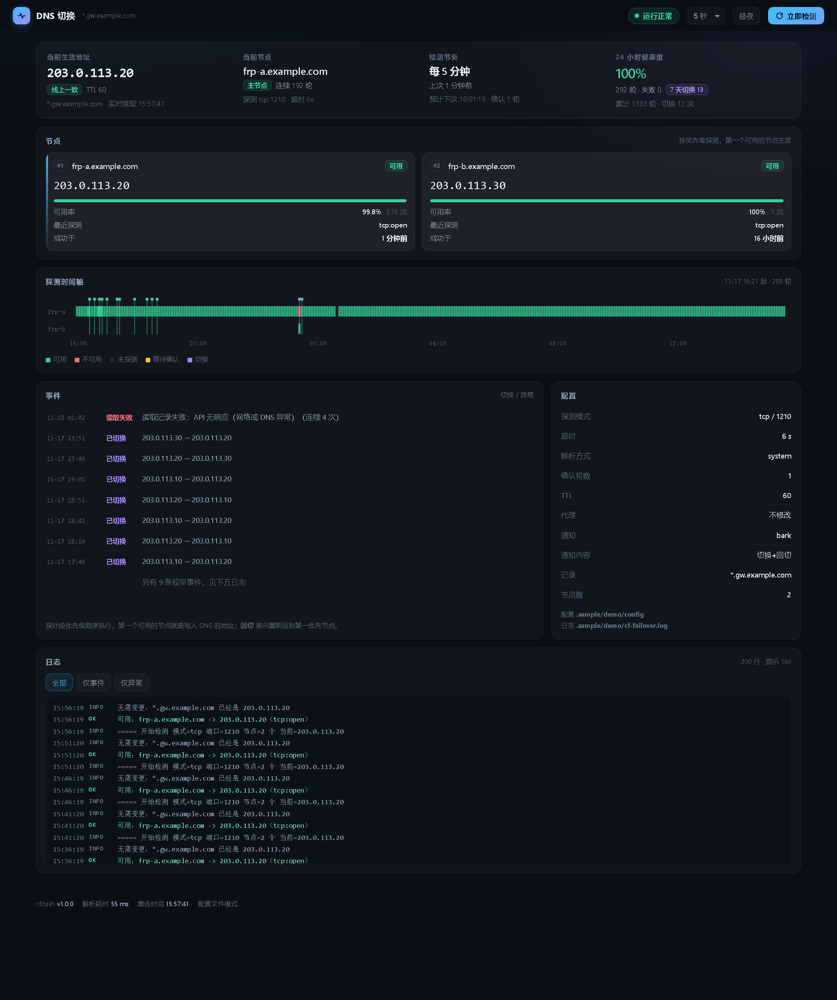

# cf-dns-failover

[](https://github.com/jhonlinus/cf-dns-failover/actions/workflows/shellcheck.yml)
[](LICENSE)
[](https://www.gnu.org/software/bash/)
[](#兼容性)

**一个极简的 Cloudflare DNS 故障转移脚本。** 按优先级探测多个节点，把第一个真正可用的 IP 写进 DNS 记录。为主备切换设计，不做负载均衡。

> [English](README.en.md)

```
节点 A 正常  ->  DNS = A 的 IP   （状态无变化，脚本退出）
节点 A 挂掉  ->  DNS = B 的 IP   （写记录 + 推送通知）
节点 A 恢复  ->  DNS = A 的 IP   （自动回切）
```

## 为什么需要它

免费版 Cloudflare 没有健康检查。多 A 记录只是把选择权丢给客户端：没有探测、按运营商缓存分布、非浏览器客户端通常不会重试第二个 IP。

真正能工作的方案只有两种：买 Cloudflare Load Balancing（$5/月起），或者自己探测并改写记录。这个脚本是后者。

它解决的问题很具体：**你有两条以上的入口线路（FRP 隧道、多机房、双宽带），希望挂了能自动切，但不想付钱，也不想被代理层拖慢延迟。**

不经过 Cloudflare 代理（灰云），只改 DNS，所以**日常延迟零额外开销**。

## 特性

- **优先级选优，不是轮询。** 每轮重新探测，第一个通的获胜，主节点恢复自动回切，不需要单独的 failback 逻辑。
- **两种探测模式。** `tcp` 只测端口，`http` 测真实业务响应，后者能发现隧道断开。
- **防抖确认。** 连续 N 轮结果一致才改写 DNS，避免链路抖动导致来回横跳。
- **读失败就不动。** 读不到记录当前值时直接退出，绝不基于错误前提盲写。
- **多记录支持。** 一次更新多条记录，互不影响。
- **九种通知渠道。** Bark、企业微信、钉钉、飞书、PushPlus、Telegram、ntfy、通用 webhook、关闭。
- **dry-run。** 完整跑一遍探测和决策，但不写 DNS、不发通知。
- **内置并发锁。** 用 `flock` 防止 cron 重叠执行。
- **零依赖。** 只用 `bash` + `curl`，没有 Python、没有编译、没有容器。
- **可选的网页面板。** `dashboard/` 里的 `cfdash` 把日志读成一张实时看板：当前生效 IP、各节点健康、切换时间线。面板只读，不改你的配置。（[看看长什么样](#监控面板cfdash)）

## 工作原理

```
                    ┌─────────────┐
                    │  cron / timer│
                    └──────┬──────┘
                           v
              ┌────────────────────────┐
              │ 1. 读取 DNS 当前值      │  GET /dns_records/{id}
              │    读失败 -> 退出       │
              └───────────┬────────────┘
                          v
              ┌────────────────────────┐
              │ 2. 按顺序探测节点       │  tcp: 连接端口
              │    第一个通的获胜       │  http: 请求业务域名
              └───────────┬────────────┘
                          v
              ┌────────────────────────┐
              │ 3. 与当前值比对         │  相同 -> 退出，不写 API
              └───────────┬────────────┘
                          v
              ┌────────────────────────┐
              │ 4. 防抖确认 (N 轮)      │  未达次数 -> 下轮再确认
              └───────────┬────────────┘
                          v
              ┌────────────────────────┐
              │ 5. PATCH 记录 + 通知    │
              └────────────────────────┘
```

一次正常运行的 API 调用是 **1 次读 + 0 次写**。

## 快速开始

### 方式一：一键安装

```bash
git clone https://github.com/jhonlinus/cf-dns-failover.git
cd cf-dns-failover
chmod +x *.sh
sudo ./install.sh
```

默认每 5 分钟通过 cron 运行。想用 systemd timer 加 `--systemd`。

### 方式二：手动部署

```bash
sudo install -m 755 cf-failover.sh /usr/local/bin/cf-failover
sudo install -d -m 700 /etc/cf-failover
sudo install -m 600 config.example /etc/cf-failover/config
sudo vi /etc/cf-failover/config

# 校验配置
sudo cf-failover --check

# 空跑，看探测结果但不写 DNS
sudo cf-failover --dry-run

# 正式运行
sudo cf-failover
```

### 方式三：不安装，直接跑

```bash
curl -fsSLO https://raw.githubusercontent.com/jhonlinus/cf-dns-failover/main/cf-failover.sh
chmod +x cf-failover.sh
./cf-failover.sh --config ./my-config --dry-run
```

## 配置

完整示例见 [`config.example`](config.example)，安装后位于 `/etc/cf-failover/config`。

### 必填项

| 键 | 说明 |
|---|---|
| `DNS_TOKEN` | Cloudflare API Token，权限 `Zone / DNS / Edit`，范围限定到单个域名 |
| `DNS_RECORDS` | 记录列表，每项格式 `"ZONE_ID\|RECORD_ID\|记录名"` |
| `NODE_HOSTS` | 节点列表，按优先级排列，可写域名或 IP |
| `PROBE_PORT` | 探测端口，FRP 场景通常是 `vhostHTTPPort` |

### 关键选项

| 键 | 默认 | 说明 |
|---|---|---|
| `PROBE_MODE` | `tcp` | `tcp` 或 `http`，见下节 |
| `PROBE_HOST` | 空 | `http` 模式必填，必须有真实隧道 |
| `PROBE_KEYWORD` | 空 | 响应体中必须包含的字符串，可进一步排除错误页 |
| `OK_CODES` | `200 301 302 307 308 401 403` | 视为健康的状态码 |
| `TIMEOUT` | `6` | 单次探测超时（秒） |
| `CONFIRM_TIMES` | `1` | 连续几轮一致才切换 |
| `DNS_TTL` | `60` | 写入时设置的 TTL，`1` 表示自动（300s） |
| `DNS_PROXIED` | 空 | 留空不动，`1` 开代理，`0` 关闭 |
| `NODE_LOOKUP` | `system` | `system` 或 `authoritative`。节点写成域名且换过 IP 时用后者，见下节 |
| `NODE_RESOLVER` | 空 | 指定解析器 IP，跳过 `getent` 以绕开 `/etc/hosts` |
| `FLUSH_DNS_CACHE` | `auto` | `auto` / `always` / `never`，解析前清本机缓存 |
| `NOTIFY_TYPE` | `none` | 通知渠道 |

#### 节点用域名还是 IP

`NODE_HOSTS` 里写域名会**每轮重新解析**，而解析结果可能不是最新的：链路里任何一层缓存都只按 TTL 过期，递归解析器不守规矩时旧答案可能多留很久。后果不是"切换慢"，而是**探到一个已经废掉的地址，判定节点故障，再把旧 IP 写回 DNS**。

两种情况都会发生：

- 节点 IP 换过一次，本机还在用旧值 → 脚本把旧 IP 写回去，服务直接断
- 域名被错误解析（劫持、hosts 残留）→ 所有节点看起来都挂了，脚本拒绝动作

写死 IP 最省事，也没有解析这一步。非要用域名，就打开权威解析：

```bash
NODE_LOOKUP="authoritative"
```

它会沿着父级往上找到该域名所在区的 NS，用 `+norecurse` 直接问，绕开全部缓存（包括 ISP 的递归解析器）。代价是每轮多几次 DNS 往返，需要 `dig`；权威服务器不可达时自动回落并告警。

`FLUSH_DNS_CACHE` 只是清本机（`resolvectl` / `systemd-resolve` / `nscd` / macOS `mDNSResponder`），清不掉上游递归解析器，也清不掉 `/etc/hosts`。真遇到旧答案，它通常救不了场，`authoritative` 才能。

`DNS_RECORDS` 支持多条，节点列表是共用的：

```bash
DNS_RECORDS=(
  "zone_id_1|record_id_1|*.gw.example.com"
  "zone_id_2|record_id_2|nas.example.com"
)
```

## 探测模式怎么选

这是使用中唯一需要判断的地方。

### `tcp` —— 只测端口

```bash
PROBE_MODE="tcp"
PROBE_PORT="1210"
```

能发现：**整机宕机、断电、线路中断。**
发现不了：**进程活着但隧道断了。**

需要理解的一点：FRP 的 `vhostHTTPPort` 是常驻监听的。`frpc` 掉线、家里宽带断开，frps 的端口照常 `listen`，TCP 三次握手依然成功。此时 `tcp` 模式会认为"一切正常"，但用户其实打不开。

如果你只需要防机器故障，用这个模式，最省事也最可靠。

### `http` —— 测真实响应

```bash
PROBE_MODE="http"
PROBE_HOST="app.gw.example.com"   # 必须有真实隧道
PROBE_PORT="1210"
PROBE_PATH="/"
PROBE_KEYWORD="<title>My App</title>"   # 可选，更严格
```

脚本用 `curl --resolve` 把探针域名强制定向到候选 IP，走完整链路：公网 IP → frps → 隧道 → 后端服务。这样隧道断开会返回 502，被判定为不可用。

前提是 `PROBE_HOST` 必须真有隧道。填错了会永远判定全挂。

> **注意**：很多 frps 对任何未匹配的 vhost 都返回 502。所以"502"只能说明请求到达了 frps，不能证明隧道状态。判断时要用状态码白名单，而不是看端口。

### 切换的判据

| 场景 | `tcp` | `http` |
|---|:---:|:---:|
| 服务器宕机 / 断电 | 检测到 | 检测到 |
| frps 进程崩溃 | 检测到 | 检测到 |
| frpc 掉线 | **漏判** | 检测到 |
| 后端服务 500 | 漏判 | 漏判（500 不在白名单） |
| 后端服务 502 | 漏判 | 检测到 |

## 通知

`NOTIFY_TYPE` 支持九种，配置全部在 `NOTIFY_URL` 一个字段里。

| 类型 | `NOTIFY_URL` 填什么 |
|---|---|
| `bark` | device key，或自建的完整 base URL |
| `wecom` | 企业微信群机器人 webhook |
| `dingtalk` | 钉钉群机器人 webhook（安全设置选关键词，填 `DNS`） |
| `feishu` | 飞书群机器人 webhook |
| `pushplus` | PushPlus token |
| `telegram` | `"<bot_token>\|<chat_id>"` |
| `ntfy` | 完整 topic URL，如 `https://ntfy.sh/my-topic` |
| `webhook` | 任意接受 JSON POST 的地址 |
| `none` | 关闭 |

配置完先测一下：

```bash
sudo cf-failover --test-notify
```

细节和各渠道的申请步骤见 [`docs/notifications.md`](docs/notifications.md)。

## 定时任务

### cron

```bash
sudo crontab -e
```

```cron
*/5 * * * * /usr/local/bin/cf-failover --quiet
```

`--quiet` 只输出错误。脚本内置 `flock`，不需要额外加锁。也不会往 stdout 打印，cron 不会给你发邮件。

### systemd timer

`install.sh --systemd` 会自动配好。手动的话：

```bash
sudo cp contrib/cf-failover.service contrib/cf-failover.timer /etc/systemd/system/
sudo systemctl daemon-reload
sudo systemctl enable --now cf-failover.timer
```

### 频率怎么定

| 频率 | 最坏切换延迟 | 建议 `CONFIRM_TIMES` |
|---|---|---|
| 1 分钟 | 约 3 分钟 | `2` |
| 5 分钟 | 约 6 分钟 | `1` |

延迟 = 探测间隔 × `CONFIRM_TIMES` + DNS TTL 生效时间。

**防抖的必要性和执行频率成反比。** 一分钟跑一次时，两次探测只隔 60 秒，运营商抖动很容易骗过它；5 分钟跑一次时，两次探测已经隔了 5 分钟，能持续 5 分钟的"抖动"已经是真故障了，二次确认纯属多等一个周期。

## 监控面板（cfdash）

脚本本身没有界面，状态只能 `tail -f` 日志。`dashboard/` 提供一个零依赖面板：一个 `cfdash.py`（Python 3.8+ 标准库）+ 一个 `index.html`，把日志读成看板。



**它能回答的问题**

- 现在 DNS 上是哪个 IP？和日志里最后一次观测的一致吗？（面板会实时调 Cloudflare API 校验，不一致直接标红）
- 哪个节点在生效？是主节点还是备用节点？连续多少轮没出过事？
- 24 小时里跑了几轮、失败几轮、切换几次？下次检测大概什么时候？
- 昨天半夜那次切换，是从哪个 IP 到哪个 IP？

**它不做什么**

- 不自己探测、不自己写 DNS —— 探测和切换永远由 `cf-failover` 完成，面板只是另一个视图。
- 不写任何配置。读 `/etc/cf-failover/config` 或 1Panel 里那份内联脚本，token 一律打码后才进浏览器。

### 启动

```bash
# 只监听本机，8077 端口
python3 dashboard/cfdash.py

# 给外网用：自己加一层带认证的反代，或者直接开 Basic 认证
python3 dashboard/cfdash.py --bind 0.0.0.0 --auth admin:你的密码

# 只读模式：页面上不出现「立即检测」按钮
python3 dashboard/cfdash.py --no-run
```

打开 `http://127.0.0.1:8077/`。

它自动在下面这些位置找安装：

| 形态 | 配置 | 日志 |
|---|---|---|
| 仓库版（推荐） | `/etc/cf-failover/config` | `/var/log/cf-failover.log` |
| 1Panel 计划任务版 | `/opt/1panel/task/shell/frp-dns-callback/frp-dns-callback.sh` | 同上 |

找不到可以显式指定：`--config /path/to/config --log /path/to/log`。

### 飞牛 fnOS 应用包

`fnos/` 是打包好的飞牛应用工程，产物 `fnos/dist/cfdns-1.0.0.fpk`：

1. 应用中心 → 设置 → 手动安装应用 → 选 `.fpk`
2. 桌面上出现「DNS 切换面板」，点开直接在桌面内打开（走统一网关 `/app/cfdns/`，不占端口）

面板以 root 运行 —— 它要读 `600` 权限的配置、写 `/var/log`，并且「立即检测」会真的跑一轮脚本。不想给这个权限就装纯查看版：改 `cmd/main` 加 `--no-run` 重新打包。细节见 [`fnos/README.md`](fnos/README.md)。

### 安全

- 默认只绑 `127.0.0.1`，**不要直接把 8077 暴露到公网**：面板能触发 root 权限的脚本执行。
- 要公网访问，务必加认证（`--auth` 或反代 Basic/OAuth），并考虑 `--no-run`。
- 「立即检测」会先弹确认框，并提供 dry-run 选项：试运行只探测、不写 DNS。
- token 只在服务端使用，接口返回里一律 `abcd****wxyz` 形式。

## 命令行

```
cf-failover [options]

  -c, --config FILE   配置文件（默认 /etc/cf-failover/config）
  -n, --dry-run       只探测和报告，不写 DNS、不发通知
  -d, --debug         输出调试信息
  -q, --quiet         只输出错误
  -t, --test-notify   发送一条测试通知后退出
      --check         校验配置后退出
      --no-color      关闭颜色
      --color         强制颜色（管道输出时用）
  -V, --version       版本
  -h, --help          帮助
```

退出码：`0` 成功或无需变更，`1` 运行失败，`2` 配置错误。

## 部署前检查清单

这几条不做的话，脚本写得再好也没用。

- [ ] **每个节点都真的在提供服务。** FRP 场景下，家里的 `frpc` 必须同时连接所有 frps。只连了一个的话，DNS 切过去只会得到一个 502。
- [ ] **TTL 改短。** 记录 TTL 还是 300 秒的话，切换完成用户还是连旧 IP。脚本写入时会设成 `DNS_TTL`，但首次运行前最好手动确认。
- [ ] **证书一致。** 如果开 HTTPS，每个节点都要有对应域名的有效证书。切换成功但证书不匹配，用户看到的是浏览器警告，比 502 更难解释。
- [ ] **别跑在会挂的节点上。** 脚本要放在独立机器上。跑在 frp1 上面，frp1 一挂脚本自己也失联了。
- [ ] **`--dry-run` 跑一次。** 确认探测结果符合预期，尤其是 `http` 模式下 `PROBE_HOST` 是否真的返回 200。

## 常见问题

**Q：为什么不直接配两条 A 记录？**

两条 A 记录没有健康检查。哪台挂了，DNS 照样返回它，直到你手动删记录。而且客户端行为不可控：运营商 DNS 缓存整个 TTL 周期、部分客户端只取列表第一个、非浏览器客户端通常不会重试。结果是流量分配严重倾斜，故障时表现为随机打不开。

**Q：和 Cloudflare Load Balancing 有什么区别？**

它做主动健康检查、在边缘摘除不健康源站、秒级切换，但需要付费（$5/月起）且必须开代理，延迟会增加。这个脚本免费、不改延迟，代价是切换要几分钟。

**Q：切换后用户多久能恢复？**

取决于 TTL。TTL 60 秒 + 下一轮 cron，实际 1–5 分钟。浏览器可能还有自己的 DNS 缓存（Chrome 的 `chrome://net-internals/#dns`），比 TTL 更顽固。

**Q：会覆盖我手动改的记录吗？**

会。脚本每轮以 Cloudflare 上的实际值为基准，你手动改的会被下一轮覆盖回它认为正确的值。想手动保持某个 IP，先停掉 cron。

**Q：支持 IPv6 / AAAA 记录吗？**

不支持。目前只处理 A 记录。AAAA 与 A 可以同时存在，脚本不会碰 AAAA。

**Q：能当负载均衡用吗？**

不能，也不应该。同一时间只有一条记录指向一个 IP。这是设计选择：多活轮询要求各节点数据完全一致，绝大多数自建服务做不到。

## 故障排查

详见 [`docs/troubleshooting.md`](docs/troubleshooting.md)。最常见的三个：

**日志里全是「所有节点均不可用」，但服务其实是好的**
`PROBE_MODE=http` 时 `PROBE_HOST` 填错，或者该域名没有隧道。换成 `tcp` 模式验证端口是否可达，再回去查隧道。

**切换了但访问还是不通**
新节点本身有问题。手动验证：

```bash
curl -o /dev/null -w "%{http_code}\n" --max-time 6 \
  --resolve app.example.com:1210:<新节点IP> \
  http://app.example.com:1210/
```

**Bark 收到通知但内容乱码**
脚本文件编码不是 UTF-8。检查 `file -i cf-failover.sh`，应为 `charset=utf-8`。用 Windows 记事本或网页编辑器保存容易变成 GBK。

## 安全

- **`DNS_TOKEN` 只给最小权限。** 用 `Zone / DNS / Edit` 模板，Zone Resources 限定到单域名。不要用 Global API Key。
- **配置文件权限 600。** `install.sh` 已经这么设了。
- **别把 token 提交进 Git。** 配置在 `/etc/cf-failover/config`，本来就不在仓库里。如果你改了配置文件路径，注意别放进仓库目录。
- **Token 泄露了立刻 Roll。** 删掉重建，一分钟的事。

## 兼容性

- **系统**：任何有 bash 4.3+ 的 Linux。Debian / Ubuntu / CentOS / Rocky / Alpine（需 `bash` 包）均可。
- **依赖**：`curl`，`timeout`（coreutils）。`flock` 可选，`dig`/`getent` 用于解析。
- **macOS**：未测试，`/dev/tcp` 和 GNU 工具链差异可能需要调整。
- **Windows**：不支持。WSL 下可用。

## 开发

```bash
# 语法检查
bash -n cf-failover.sh

# shellcheck
shellcheck cf-failover.sh install.sh uninstall.sh

# 用测试配置空跑
./cf-failover.sh --config ./test-config --dry-run --debug
```

提交前请确保 shellcheck 无告警。CI 会跑同样的检查。

## 相关项目

- [fatedier/frp](https://github.com/fatedier/frp) — 内网穿透，本脚本最常见的搭配场景
- [jinqians/cloudflare_dns](https://github.com/jinqians/cloudflare_dns) — 同类方案，专注主备两节点，带 Telegram 通知
- [cycneuramus/cloudflare-dns-failover](https://github.com/cycneuramus/cloudflare-dns-failover) — Go 实现，常驻进程

## License

[MIT](LICENSE) © 2026 JhonLinus
